# Trace — Repository Investigation Agent

An independent engineering project by Manenimabasi Udoh. Trace documents and investigates one public Go repository at an immutable commit, then checks source references and model claim support separately. It produces a human-review report, not an automatic patch.

**Hosted app:** https://repository-investigation-agent.onrender.com  
**Public saved-report viewer:** https://repository-investigation-agent.vercel.app  
**Source:** https://github.com/manenim/repository-investigation-agent

The app is deployed on Render Free with managed PostgreSQL 18. Health/readiness and authenticated run storage work. **The hosted generation smoke test is blocked by GitHub HTTP 403: a dedicated read-only GitHub credential is still required.** GitHub requires owner reauthentication before creating it. Full live-model generation, exports and container persistence have been tested locally; the saved public report was generated with the real model and real GitHub ingestion.

The free database expires **3 December 2026**, the current model key expires **10 November 2026**, and the free web service sleeps when idle. Export reports before expiry. No paid resources or recurring subscription were purchased. See `docs/deployment.md` for deployment evidence and exact remaining steps.

## Run locally

Python 3.12+:

```sh
python3 -m venv .venv
.venv/bin/pip install -r requirements.lock
cp .env.example .env
# Set OPENAI_API_KEY and a random ACCESS_TOKEN of at least 24 characters in .env.
.venv/bin/uvicorn app.main:app --host 127.0.0.1 --port 8765 --workers 1
```

Open http://localhost:8765. Enter the demo access token from your local `.env` into the web form; it stays in that tab's memory. Use `manenim/gateway-rate-limiter`, `main` or a commit SHA, and a pasted issue or real GitHub issue URL. API documentation is at `/docs`.

The existing local `.env` is ignored and owner-readable only. Its OpenAI key expires **10 November 2026**. Never publish it or include it in screenshots, issues, archives, or build contexts.

For an explicit offline extractive sample, set `PROVIDER=sample` and `SOURCE_MODE=snapshot`. This provider quotes source and always declares insufficient evidence; it does not simulate live model intelligence. To use live models with reproducible source, set `PROVIDER=openai` and `SOURCE_MODE=snapshot`; the resulting report explicitly identifies its source as `pinned_fixture`.

## Architecture

```mermaid
flowchart LR
  UI[Web form] --> API[FastAPI validation and access control]
  API --> Q[Bounded in-process queue]
  Q --> GH[GET-only GitHub ingestion]
  GH --> SHA[Commit SHA and hash-checked source snapshot]
  SHA --> R[Lexical and symbol retrieval]
  R --> D[Documentation stage]
  D --> I[Investigation stage]
  I --> V[Reference checks and separate semantic review]
  V --> DB[(SQLite volume / managed Postgres)]
  DB --> OUT[Review UI and Markdown / JSON exports]
```



See `docs/architecture.md` for context selection, trust boundaries and failure handling, and `docs/architecture.svg` for an image.

## Supported repository and evidence

Live inspection of both candidate repositories selected `gateway-rate-limiter`: 40 tracked files at inspection, small source surface, and an actual issue #1 about diagram portability. `task-orchestrator` has a broader storage/gRPC surface; its issue collection contained a pull request but no ordinary issue. No synthetic issues were posted.

Evaluation fixtures pin `50eb89b722a068b2e63fa1dfe2a87d2605ae564a`. `evals/snapshot.json` stores the original public files, Git blob hashes, tree inventory and issue #1. Live runs resolve the chosen ref afresh and fetch blobs from that commit's tree. Repository code, scripts and tests are never executed.

Each citation includes repository, immutable commit, path, original start/end lines, permalink and excerpt. Reports retain full ingested source blobs to reproduce the citations. Reference verification checks blob hashes, paths, ranges, excerpts and permalinks. Semantic review is a separately prompted model call requiring a source quotation from the claim's own cited evidence. A deterministic gate rejects missing or mismatched quotations. An exact quotation still does **not** prove entailment: model review and human review remain fallible.

## Endpoints

| Endpoint | Behavior |
|---|---|
| `POST /investigations` | Authenticated input validation and queue admission; returns 202 and run ID |
| `GET /investigations/{id}` | Authenticated status, stage artifacts, progress, errors and report |
| `GET /investigations/{id}/report.md` | Authenticated Markdown download after completion |
| `GET /investigations/{id}/report.json` | Authenticated full report and snapshot export |
| `GET /sample`, `/sample.md` | Public saved report only |
| `GET /health` | Process liveness |
| `GET /ready` | Database access and worker-task liveness; not upstream-provider availability |

Protected endpoints require `Authorization: Bearer <ACCESS_TOKEN>`. This is a single-operator demo token, not a multi-user identity system. Run IDs alone confer no access. The UI preserves `?run=<id>` in the page URL; reopen it and enter the access token to load a saved report. No cross-origin API access is enabled.

## Configuration and budgets

| Variable | Default / meaning |
|---|---|
| `OPENAI_API_KEY` | Required for live model calls; server-side only |
| `OPENAI_MODEL` | `gpt-4o-mini`; a configurable model must support Responses structured output |
| `ACCESS_TOKEN` | Required, at least 24 characters; use a cryptographically random value |
| `GITHUB_TOKEN` | Optional narrowly scoped read token for public GitHub rate limits |
| `DATABASE_URL` | Managed PostgreSQL connection; overrides SQLite. Required on Render; invalid/ephemeral storage is refused |
| `DEPLOYMENT_NOTICE` | Optional public notice; hosted demo displays database/key expiry |
| `DB_PATH` | `data/investigations.sqlite3`; must be on a persistent volume in deployment |
| `SOURCE_MODE` | `github` or explicit `snapshot` fixture mode |
| `PROVIDER` | `openai` or explicit `sample` extractive provider |
| `MAX_DAILY_RUNS` | 20 persisted submissions per UTC day, including failed runs |
| `MAX_STORED_RUNS` | 200; refuse new runs when full rather than silently evict reports |

The hosted demo permits five submissions per day; local default is 20. One active run; at most four waiting. Three admissions per minute globally. Issue title/body limits are 200/6,000 characters and POST bodies are limited to 12 KB. Inventory has at most 2,000 entries; at most 60 eligible files, 40 KB/file, 512 KB total decoded source. A response-level streaming cap also bounds GitHub JSON. Binary, symlink, vendor, generated and benchmark-record content is skipped. Oversized inventories fail explicitly; skipped files are reported.

Retrieval selects at most ten overlapping 44-line chunks, under 20 KB including metadata allowances. Model payload plus instructions cannot exceed 52 KB; UTF-8 bytes provide a conservative text-token upper bound. Output is capped at 3,500 tokens per call. Each transient upstream operation has at most three attempts with short exponential backoff; whole runs have a 420-second deadline. Input length, retries and daily runs are usage bounds, not a monetary billing guarantee. Token usage is stored; billed dollars are not inferred.

## Check and evaluate

```sh
.venv/bin/ruff check app tests scripts
.venv/bin/ruff format --check app tests scripts
.venv/bin/mypy app
.venv/bin/python -m pytest -q --junitxml=evals/results/tests.xml
.venv/bin/python -m scripts.evaluate
# Explicit live calls consume API quota; use an isolated evaluation database.
.venv/bin/python -m scripts.evaluate --live
.venv/bin/python -m scripts.claim_probe
```

The 12 source-inspected cases cover architecture, retrieval, known code scenarios and two insufficient-evidence questions. Three adversarial mutations cover a hostile README, secret-seeking issue, and source comment redirecting tool use. `docs/evaluation.md` defines metrics, fixture basis, manual rubric and observed limitations. Raw results are in `evals/results`; deterministic tests are separate from actual live-provider results. The CI workflow runs the application checks, deterministic evaluation and container build; live checks are deliberately not automatic on PRs. Hosted [CI passed](https://github.com/manenim/repository-investigation-agent/actions/runs/41667367525) on commit `03288fc`; later source revisions have their own checks.

## Docker and persistence

```sh
docker compose up --build -d
curl --fail http://localhost:8000/health
curl --fail http://localhost:8000/ready
docker compose restart trace
```

For Render, `DATABASE_URL` uses managed Postgres rather than a local file. The SQLite and Postgres adapters share fixed, parameterized SQL and run the same workflow; the single process reuses its Postgres connection, with transaction boundaries per store operation.

The non-root container uses a named `reports` volume for SQLite and binds the service to localhost by default. Place it behind HTTPS on an existing host to publish the full service. Exactly one process and one replica are supported; do not increase Uvicorn workers or horizontally scale. Runs interrupted by shutdown/restart are marked failed rather than replaying paid calls. Completed reports survive restart. This is not a durable queue or distributed execution system. Back up SQLite using its online backup API, including normal WAL semantics; do not delete the volume when upgrading.

## Demo and portfolio material

- `evals/sample-report.md` and `.json`: actual saved report, exact source snapshot and model usage.
- `docs/demo.md`: concise end-to-end script.
- `docs/case-study.md`: actual engineering decisions, observed failures and limits.
- `docs/portfolio.md`: two CV bullets and interview explanation limited to completed work.
- `docs/deployment.md`: public sample deployment and full-service steps/blocker.

The SDK implementation follows the current official [OpenAI structured-output guide](https://developers.openai.com/api/docs/guides/structured-outputs?api-mode=responses). Vercel [Daemons currently have ephemeral storage](https://vercel.com/docs/daemons#what-does-the-daemons-beta-support); deploying this exact SQLite worker there would lose reports. Render's [persistent disks require a paid service](https://render.com/docs/disks), so no paid disk was provisioned without authorization.
