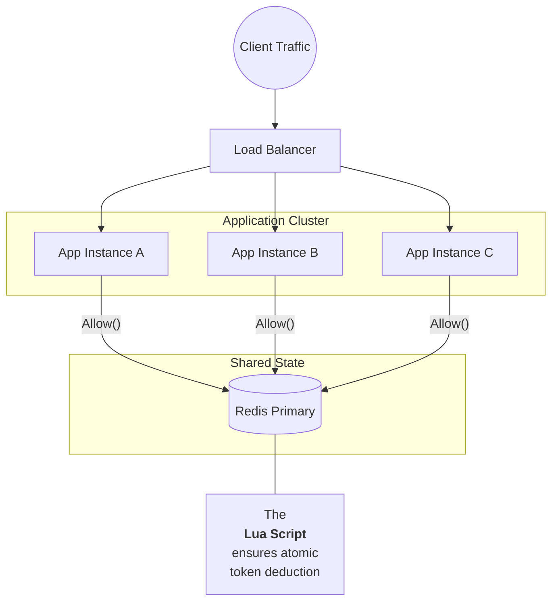
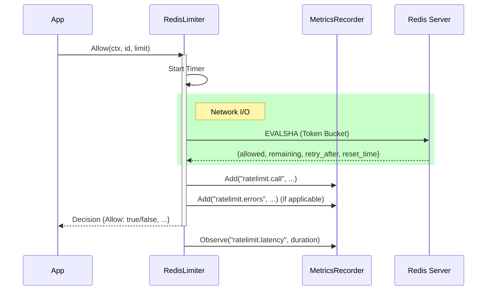

# Repository investigation

- Run: `9ed0f84810e0474d9f9ad30957363176`
- Repository: manenim/gateway-rate-limiter
- Commit: `50eb89b722a068b2e63fa1dfe2a87d2605ae564a`
- Created: 2026-11-03T15:12:45.878250+00:00
- Mode: live_model; model: gpt-4o-mini; prompt: evidence-v1

## Issue context

Docs: Convert Mermaid diagrams to static images for pkg.go.dev compatibility

**The Problem**
Our `README.md` currently uses Mermaid code blocks to render architecture and sequence diagrams. While these render correctly on GitHub, they **do not render on [pkg.go.dev](https://pkg.go.dev/github.com/manenim/gateway-rate-limiter)** (Go's official documentation site), which displays them as raw code blocks.

**The Goal**
We need to convert these dynamic code blocks into static PNG images so they display correctly on all documentation platforms.

**Steps to Fix**
1.  **Generate Images:**
    - Copy the Mermaid code blocks from `README.md`.
    - Use the [Mermaid Live Editor](https://mermaid.live/) (or the `mmdc` CLI) to generate high-quality PNGs.
    - *Tip:* Ensure the background is transparent or neutral if possible.
2.  **Save Files:**
    - Save the images into the `docs/` folder (e.g., `docs/architecture.png`, `docs/sequence.png`).
3.  **Update README:**
    - Replace the mermaid code blocks in `README.md` with standard Markdown image links.
    - **Crucial:** You must use **absolute URLs** pointing to the raw file on GitHub to ensure they load on external sites.
    - Example format: ``
4.  **Verify:**
    - Ensure the images load correctly in the GitHub preview before submitting your Pull Request.

**Resources**
- [Mermaid Live Editor](https://mermaid.live/)
- Current `README.md` with diagrams.

## Outcome

Evidence-backed draft ready for human review; model judgments are not guarantees.

## Architecture and relevant code paths

- **[supported; confidence=high]** The system architecture of the Gateway Rate Limiter uses a distributed rate limiting approach leveraging Redis and Lua scripts for atomic operations.
  - Evidence: E2, E6, E8; reference valid: True
  - Verification: The architecture of the Gateway Rate Limiter uses Redis and Lua scripts for atomic operations, as detailed in evidence E2 and E6.
  - Counter-evidence/limits: 
- **[supported; confidence=high]** The architecture consists of multiple application nodes behind a load balancer, with shared state maintained in Redis.
  - Evidence: E2, E4; reference valid: True
  - Verification: The architecture describes multiple application nodes behind a load balancer with shared state in Redis, supported by evidence E2 and E4.
  - Counter-evidence/limits: 
- **[supported; confidence=high]** The RateLimiter interface defines the core rate-limiting functionality, allowing checking whether requests should be allowed based on token buckets.
  - Evidence: E1, E7; reference valid: True
  - Verification: The RateLimiter interface defines core rate-limiting functionality based on token buckets, validated by evidence E1 and E7.
  - Counter-evidence/limits: 
- **[supported; confidence=high]** The system supports both in-memory and Redis-backed rate limiting implementations to accommodate different deployment needs.
  - Evidence: E1, E6; reference valid: True
  - Verification: System support for both in-memory and Redis-backed implementations is specified in evidence E1 and E6.
  - Counter-evidence/limits: 

## Direct observations

- **[supported; confidence=high]** The README.md currently uses Mermaid code blocks to render architecture and sequence diagrams, which do not render on pkg.go.dev.
  - Evidence: E5; reference valid: True
  - Verification: The README.md mentions the use of Mermaid code blocks for diagram rendering, corroborated by evidence E5.
  - Counter-evidence/limits: 
- **[supported; confidence=high]** Pkg.go.dev displays raw code blocks instead of rendered diagrams due to the unsupported Mermaid format.
  - Evidence: E5; reference valid: True
  - Verification: Pkg.go.dev displays raw code blocks instead of rendered diagrams due to unsupported format, as confirmed by evidence E5.
  - Counter-evidence/limits: 
- **[supported; confidence=high]** The steps to fix the issue include generating images, saving them in the docs folder, updating README.md, and verifying the images.
  - Evidence: E5; reference valid: True
  - Verification: The steps for generating images and updating README.md are documented in evidence E5.
  - Counter-evidence/limits: 
- **[supported; confidence=high]** The diagrams in the README.md are essential for understanding the system architecture and flow.
  - Evidence: E5; reference valid: True
  - Verification: The role of diagrams in the README.md for understanding architecture is emphasized in evidence E5.
  - Counter-evidence/limits: 

## Hypotheses (not established causes)

- **[plausible; confidence=medium]** The proposal suggests converting the dynamic Mermaid code blocks into static PNG images for compatibility on pkg.go.dev.
  - Evidence: E1, E3; reference valid: True
  - Verification: The proposal to convert dynamic Mermaid blocks to static images is a hypothesis grounded in the issue of compatibility with pkg.go.dev, noted in evidence E1 and E3.
  - Counter-evidence/limits: 
- **[plausible; confidence=medium]** Static images of diagrams can display correctly on pkg.go.dev and will resolve the display issue in documentation.
  - Evidence: E1, E2; reference valid: True
  - Verification: The hypothesis that static images will resolve display issues is reasonable given evidence E1 and E2.
  - Counter-evidence/limits: 

## Proposed fix and validation plan (not executed)

- Convert Mermaid diagrams to PNG images.
  - Affected files: README.md, docs/architecture.md, docs/sequence.md
  - Compatibility: Changes will ensure compatibility on pkg.go.dev.
  - Proposed checks: Validate by checking the rendered images on pkg.go.dev after conversion.
- Update README.md with absolute URLs to the new PNG images.
  - Affected files: README.md
  - Compatibility: Maintains existing functionality while enhancing compatibility for external documentation sites.
  - Proposed checks: Ensure the links to images are functional and images load correctly in GitHub.
- Verify that images render correctly in GitHub preview and on pkg.go.dev.
  - Affected files: README.md
  - Compatibility: Fixes issues across multiple documentation platforms.
  - Proposed checks: Confirm by reviewing final rendering on both GitHub and pkg.go.dev.

## Tests actually run by this investigation

None. Target repository code is never executed.

## Evidence and deterministic citation verification

## Proposal path review


### E1: [model.go:1-44](https://github.com/manenim/gateway-rate-limiter/blob/50eb89b722a068b2e63fa1dfe2a87d2605ae564a/model.go#L1-L44)

Repository: manenim/gateway-rate-limiter; commit: `50eb89b722a068b2e63fa1dfe2a87d2605ae564a`; valid: True

~~~~text
package limiter

import (
	"context"
	"time"
)

type Namespace string

// Limit defines a token-bucket policy.
//
// Rate is measured as tokens per Period. Burst is the maximum token capacity of
// the bucket and controls how many requests can be allowed immediately.
type Limit struct {
	Rate   int64
	Period time.Duration
	Burst  int64
}

// Decision is the result of a rate-limit check.
type Decision struct {
	Allow      bool
	Remaining  int64
	RetryAfter time.Duration
	ResetTime  time.Time
}

// Identity uniquely identifies the subject being rate-limited (for example,
// a user ID, an API key, or an IP address).
type Identity struct {
	Namespace Namespace
	Key       string
}

// RateLimiter performs token-bucket admission control.
type RateLimiter interface {
	Allow(ctx context.Context, id Identity, limit Limit) (Decision, error)
}

// MetricsRecorder defines the interface for collecting telemetry.
// We abstract this so we aren't tied to Prometheus, Datadog, or any specific vendor.
type MetricsRecorder interface {
	// Add increments a counter (e.g., requests_total)
	Add(name string, value float64, tags map[string]string)
~~~~

### E2: [docs/architecture.md:1-29](https://github.com/manenim/gateway-rate-limiter/blob/50eb89b722a068b2e63fa1dfe2a87d2605ae564a/docs/architecture.md#L1-L29)

Repository: manenim/gateway-rate-limiter; commit: `50eb89b722a068b2e63fa1dfe2a87d2605ae564a`; valid: True

~~~~text
# System Architecture

How the Distributed Rate Limiter works across multiple nodes.


~~~~

### E3: [docs/sequence.md:1-31](https://github.com/manenim/gateway-rate-limiter/blob/50eb89b722a068b2e63fa1dfe2a87d2605ae564a/docs/sequence.md#L1-L31)

Repository: manenim/gateway-rate-limiter; commit: `50eb89b722a068b2e63fa1dfe2a87d2605ae564a`; valid: True

~~~~text
# Sequence Diagram

The flow of a single `Allow()` call.


~~~~

### E4: [CONTRIBUTING.md:1-44](https://github.com/manenim/gateway-rate-limiter/blob/50eb89b722a068b2e63fa1dfe2a87d2605ae564a/CONTRIBUTING.md#L1-L44)

Repository: manenim/gateway-rate-limiter; commit: `50eb89b722a068b2e63fa1dfe2a87d2605ae564a`; valid: True

~~~~text
# Contributing to Gateway Rate Limiter

First off, thank you for considering contributing to this project! It's people like you that make the open-source community such an amazing place to learn, inspire, and create.

## How Can I Contribute?

### 1. Reporting Bugs
- Ensure the bug was not already reported by searching on GitHub under Issues.
- If you're unable to find an open issue addressing the problem, open a new one. Be sure to include a title and clear description, as well as a code sample or an executable test case demonstrating the expected behavior that is not occurring.

### 2. Suggesting Enhancements
- Open a new issue with a clear title and detailed description.
- Explain why this enhancement would be useful to most users.

### 3. Pull Requests
We love PRs! Here is the workflow we recommend:

1. Fork the repo and create your branch from `main`.
2. Test your changes. We have a high bar for stability.
3. Lint your code using `golangci-lint` or standard `go fmt`.
4. Submit that PR.

## Development Guidelines

### 1. Style & Linting
- We follow standard Go idioms (Effective Go).
- Run `gofmt -s -w .` before committing.
- Ensure your code passes the linter (if applicable) and has no ineffectual assignments.

### 2. Testing Requirements (Strict)
This library is used in high-throughput hot paths. We cannot accept PRs that break stability.

- Unit Tests: Any new logic must be covered by a unit test.
- Race Detection: Run tests with the race detector enabled.

```bash
REDIS_ADDR=localhost:6379 REQUIRE_REDIS=1 go test -v -race -count=1 ./...
```

- Allocations: If you modify the MemoryLimiter or the hot path of RedisLimiter, please run benchmarks to ensure no unnecessary allocations were added.

```bash
REDIS_ADDR=localhost:6379 ./scripts/verify.sh
```
~~~~

### E5: [README.md:1-44](https://github.com/manenim/gateway-rate-limiter/blob/50eb89b722a068b2e63fa1dfe2a87d2605ae564a/README.md#L1-L44)

Repository: manenim/gateway-rate-limiter; commit: `50eb89b722a068b2e63fa1dfe2a87d2605ae564a`; valid: True

~~~~text
# Distributed Rate Limiter

[](https://goreportcard.com/report/github.com/manenim/gateway-rate-limiter) [](https://github.com/manenim/gateway-rate-limiter/actions/workflows/ci.yml) [](https://pkg.go.dev/github.com/manenim/gateway-rate-limiter) [](https://opensource.org/licenses/MIT)

A Redis-backed, distributed token bucket rate limiter for Go.

This repo ships:

- A reusable library (root `limiter` package) with a small, testable API
- A Redis Lua script embedded in the binary for atomic token-bucket updates
- A runnable example server (`cmd/example-server`)
- Mermaid diagrams in `docs/`

## Contents

- [Distributed Rate Limiter](#distributed-rate-limiter)
  - [Contents](#contents)
  - [Features](#features)
  - [Requirements](#requirements)
  - [Installation](#installation)
  - [Quick start (Redis-backed)](#quick-start-redis-backed)
  - [Core Concepts](#core-concepts)
    - [Core types](#core-types)
    - [Interface + implementations](#interface--implementations)
    - [Redis key format](#redis-key-format)
  - [Usage patterns](#usage-patterns)
    - [In-memory limiter (tests / single-instance)](#in-memory-limiter-tests--single-instance)
    - [HTTP integration (returning 429)](#http-integration-returning-429)
    - [Fail open vs fail closed](#fail-open-vs-fail-closed)
  - [Configuration](#configuration)
  - [Observability (metrics)](#observability-metrics)
  - [How it works](#how-it-works)
    - [Token bucket (conceptual)](#token-bucket-conceptual)
    - [Redis atomic update (implementation)](#redis-atomic-update-implementation)
    - [Redis data model](#redis-data-model)
  - [Architecture](#architecture)
  - [Sequence](#sequence)
  - [Example server](#example-server)
  - [Docker](#docker)
  - [Testing](#testing)
  - [Performance](#performance)
    - [Reproduce benchmarks and profiles](#reproduce-benchmarks-and-profiles)
  - [Operational boundaries](#operational-boundaries)

~~~~

### E6: [doc.go:69-112](https://github.com/manenim/gateway-rate-limiter/blob/50eb89b722a068b2e63fa1dfe2a87d2605ae564a/doc.go#L69-L112)

Repository: manenim/gateway-rate-limiter; commit: `50eb89b722a068b2e63fa1dfe2a87d2605ae564a`; valid: True

~~~~text
// caller decides whether to deny traffic (protect the backend) or allow traffic
// (maximize availability).
//
// # Decision Semantics
//
// Decision fields are intended to be directly consumable by application code:
//
//   - Allow reports whether the current request is permitted.
//   - Remaining is the number of whole tokens remaining after the decision is
//     applied (floored to an int64).
//   - RetryAfter is 0 when allowed; when denied it is the approximate duration
//     until a single token is expected to be available.
//   - ResetTime is the absolute timestamp corresponding to time.Now()+RetryAfter.
//
// # Usage
//
// For a runnable example using MemoryLimiter, see ExampleMemoryLimiter in
// example_test.go.
//
// # Storage Details
//
// MemoryLimiter stores state in a process-local map keyed by:
//
//	"{namespace}:{key}"
//
// RedisLimiter stores state in Redis under keys prefixed with "limiter:" and
// uses a Redis hash with two fields:
//
//   - "tokens": current token balance (float)
//   - "last_refill": last update time as seconds since epoch (float)
//
// Redis keys are set to expire to avoid leaking memory for identities that stop
// sending requests.
//
// # Limitations and Notes
//
//   - MemoryLimiter does not evict old identities; for long-lived processes with
//     high-cardinality keys you likely want RedisLimiter or a custom in-memory
//     store with TTL/LRU eviction.
//   - RedisLimiter requires a reachable Redis instance and returns errors
//     directly; callers must decide their availability vs protection tradeoff.
//   - This package currently models each Allow call as a cost of 1 token.
//   - RedisLimiter uses EVALSHA; if Redis is restarted and script cache is
//     cleared, Allow may return a NOSCRIPT error until the script is reloaded
~~~~

### E7: [doc.go:35-78](https://github.com/manenim/gateway-rate-limiter/blob/50eb89b722a068b2e63fa1dfe2a87d2605ae564a/doc.go#L35-L78)

Repository: manenim/gateway-rate-limiter; commit: `50eb89b722a068b2e63fa1dfe2a87d2605ae564a`; valid: True

~~~~text
//   - Namespace: a logical grouping (for example, "user", "ip", "api_key")
//   - Key: the identifier within that namespace (for example, "user_123")
//
// # Backends
//
// The package provides two implementations with the same Allow API:
//
//   - MemoryLimiter: an in-process limiter backed by a Go map. This is useful
//     for unit tests, local development, and single-instance deployments.
//     Because its state is local to the process, it does not enforce a global
//     limit across multiple replicas.
//
//   - RedisLimiter: a distributed limiter backed by Redis. It uses a Lua script
//     to perform the read/compute/write cycle atomically, which makes it safe to
//     use across many application instances while enforcing a single global
//     budget per identity.
//
// Recommendation: use RedisLimiter in production when you need a global limit,
// and MemoryLimiter in tests (as a fast, dependency-free stand-in).
//
// # Concurrency
//
// MemoryLimiter is safe for concurrent use by multiple goroutines (it uses a
// mutex to protect its internal map and per-identity state). RedisLimiter
// delegates concurrency safety to Redis and the go-redis client.
//
// # Context and Error Policy
//
// Allow accepts a context.Context. RedisLimiter passes this context through to
// Redis operations so callers can enforce deadlines and cancel work to avoid
// cascading failures during partial outages.
//
// This package does not impose a "fail open" vs "fail closed" policy. If Redis
// is unavailable or the context expires, Allow returns a non-nil error and the
// caller decides whether to deny traffic (protect the backend) or allow traffic
// (maximize availability).
//
// # Decision Semantics
//
// Decision fields are intended to be directly consumable by application code:
//
//   - Allow reports whether the current request is permitted.
//   - Remaining is the number of whole tokens remaining after the decision is
//     applied (floored to an int64).
~~~~

### E8: [cmd/example-server/main.go:1-44](https://github.com/manenim/gateway-rate-limiter/blob/50eb89b722a068b2e63fa1dfe2a87d2605ae564a/cmd/example-server/main.go#L1-L44)

Repository: manenim/gateway-rate-limiter; commit: `50eb89b722a068b2e63fa1dfe2a87d2605ae564a`; valid: True

~~~~text
package main

import (
	"fmt"
	"log"
	"math"
	"net"
	"net/http"
	"os"
	"time"

	"github.com/manenim/gateway-rate-limiter"
	"github.com/redis/go-redis/v9"
)

func main() {
	redisAddr := os.Getenv("REDIS_ADDR")
	if redisAddr == "" {
		redisAddr = "localhost:6379"
	}

	opts := &redis.Options{Addr: redisAddr, ContextTimeoutEnabled: true}
	client := redis.NewClient(opts)
	defer client.Close()

	l, err := limiter.NewRedisLimiter(client,
		limiter.WithPrefix("demo:"),
		limiter.WithTimeout(100*time.Millisecond),
	)
	if err != nil {
		log.Fatal(err)
	}

	http.Handle("/ping", pingHandler(l))

	log.Printf("Server listening on :8080 (Redis: %s)", redisAddr)
	log.Fatal(http.ListenAndServe(":8080", nil))
}

// The demo enforces a quota per directly connected IP. Deployments behind a
// proxy need a trusted proxy policy before using forwarded identity headers.
func pingHandler(l limiter.RateLimiter) http.Handler {
	return http.HandlerFunc(func(w http.ResponseWriter, r *http.Request) {
		ip, _, err := net.SplitHostPort(r.RemoteAddr)
~~~~

### E9: [docs/performance.md:35-78](https://github.com/manenim/gateway-rate-limiter/blob/50eb89b722a068b2e63fa1dfe2a87d2605ae564a/docs/performance.md#L35-L78)

Repository: manenim/gateway-rate-limiter; commit: `50eb89b722a068b2e63fa1dfe2a87d2605ae564a`; valid: True

~~~~text

## Three measured samples per workload

Commands: `go test -run '^$' -bench . -benchmem -benchtime=1s -count=3 .`
with the environment above. [Full raw benchmark output](benchmark-records/2026-10-03/benchmarks.txt).

| Workload | ns/op, three samples | B/op | allocs/op |
| --- | --- | --- | --- |
| Memory, allowed | 190.8 / 182.6 / 181.5 | 16 | 1 |
| Memory, denied | 229.6 / 211.0 / 164.5 | 16 | 1 |
| Memory, parallel shared bucket | 228.6 / 200.5 / 202.4 | 16 | 1 |
| Redis, allowed, sequential | 78,464 / 72,371 / 86,828 | 1,279 | 23 |
| Redis, denied, sequential | 69,389 / 68,595 / 102,453 | 1,279 / 1,279 / 1,271 | 21 |

Each benchmark repeatedly checks one initialized identity. Allowed cases use a
large burst/high refill rate and assert allowance on every operation. Denied
cases consume the initial token first and use a one-day refill period. Bucket
creation and Redis script loading are outside the timed loop. The parallel
memory case uses `RunParallel` against one bucket with four workers by default.

These Redis numbers include client/network/response decoding and inline metrics
hooks. They do not measure Redis-side Lua execution time or p95/p99 HTTP request
latency. Redis parallel throughput, high-cardinality identities, failover, and
cross-host networks have not been benchmarked here. The memory implementation's
global mutex also serializes different identities.

## Profiles from separate runs

`verify.sh` executes CPU and heap profiling for the allowed/denied memory paths
and mutex profiling for the parallel shared bucket. Profile-run timings are not
included in the sample table.

- [CPU top](benchmark-records/2026-10-03/cpu-top.txt): 6.72 seconds of samples;
  `time.runtimeNow` accounts for 20.83% flat and `runtime.concatstrings` for
  11.31% flat. String concatenation and allocation are visible costs in this run.
- [Heap allocation top](benchmark-records/2026-10-03/heap-top.txt): sampled
  allocation space attributes 465.51 MB (99.31%) to `MemoryLimiter.Allow` across
  the profiling run. This is cumulative allocated space, not retained memory or
  a per-request measurement; the benchmark reports 16 B/op and one allocation.
- [Mutex top](benchmark-records/2026-10-03/mutex-top.txt): sampled aggregate mutex
  delay is 4.47 seconds, attributed to the lock's release in `MemoryLimiter.Allow`.
  Delay sums across workers and is not the latency of one request.

The script writes raw `.pprof` files and the test executable into `evidence/`.
~~~~

### E10: [README.md:35-78](https://github.com/manenim/gateway-rate-limiter/blob/50eb89b722a068b2e63fa1dfe2a87d2605ae564a/README.md#L35-L78)

Repository: manenim/gateway-rate-limiter; commit: `50eb89b722a068b2e63fa1dfe2a87d2605ae564a`; valid: True

~~~~text
    - [Redis data model](#redis-data-model)
  - [Architecture](#architecture)
  - [Sequence](#sequence)
  - [Example server](#example-server)
  - [Docker](#docker)
  - [Testing](#testing)
  - [Performance](#performance)
    - [Reproduce benchmarks and profiles](#reproduce-benchmarks-and-profiles)
  - [Operational boundaries](#operational-boundaries)

## Features

- **Redis-backed distributed state**: enforce one global limit across many app instances.
- **Atomicity via Lua**: token refill + deduction happens server-side as a single atomic operation.
- **Context support**: `Allow()` passes the caller context to go-redis; configure `ContextTimeoutEnabled` to apply deadlines to network I/O.
- **Pluggable metrics**: bring your own Prometheus/DataDog/Otel adapter via a tiny interface.
- **In-memory implementation**: dependency-free `MemoryLimiter` for tests and local dev.

## Requirements

- Go `1.24.5` (see `go.mod`)
- Redis (only required for `RedisLimiter`; `MemoryLimiter` is dependency-free)

## Installation

```bash
go get github.com/manenim/gateway-rate-limiter
```

Import the library package:

```go
import "github.com/manenim/gateway-rate-limiter"
```

If you prefer to be explicit about versions:

```bash
go get github.com/manenim/gateway-rate-limiter@latest
```

## Quick start (Redis-backed)

```go
~~~~

## Unresolved questions


## Human review checklist

- [ ] Read cited source at the pinned commit.
- [ ] Review model support judgments; they are not a correctness guarantee.
- [ ] Validate hypotheses and proposed changes in a separate trusted development workflow.
- [ ] Run proposed correctness and performance checks before accepting a fix.

## Stage timings and usage

{'ingestion': 12.688, 'retrieval': 0.036, 'documentation': 6.596, 'investigation': 7.263, 'verification': 5.374}

[{'stage': 'documentation', 'attempt': 1, 'input_tokens': 6326, 'input_tokens_details': {'cache_write_tokens': 0, 'cached_tokens': 0}, 'output_tokens': 240, 'output_tokens_details': {'reasoning_tokens': 0}, 'total_tokens': 6566}, {'stage': 'investigation', 'attempt': 1, 'input_tokens': 6643, 'input_tokens_details': {'cache_write_tokens': 0, 'cached_tokens': 0}, 'output_tokens': 493, 'output_tokens_details': {'reasoning_tokens': 0}, 'total_tokens': 7136}, {'stage': 'semantic_verification', 'attempt': 1, 'input_tokens': 6472, 'input_tokens_details': {'cache_write_tokens': 0, 'cached_tokens': 0}, 'output_tokens': 389, 'output_tokens_details': {'reasoning_tokens': 0}, 'total_tokens': 6861}]

Skipped paths: .github/workflows/ci.yml, .github/workflows/goreportcard.yml, .gitignore, Dockerfile, LICENSE, docs/benchmark-records/2026-10-03/benchmarks.txt, docs/benchmark-records/2026-10-03/contention.txt, docs/benchmark-records/2026-10-03/cpu-top.txt, docs/benchmark-records/2026-10-03/environment.txt, docs/benchmark-records/2026-10-03/heap-top.txt, docs/benchmark-records/2026-10-03/mutex-run.txt, docs/benchmark-records/2026-10-03/mutex-top.txt, docs/benchmark-records/2026-10-03/profile-run.txt, docs/benchmark-records/2026-10-03/tests.txt, go.sum, scripts/verify.sh
